<p align="center">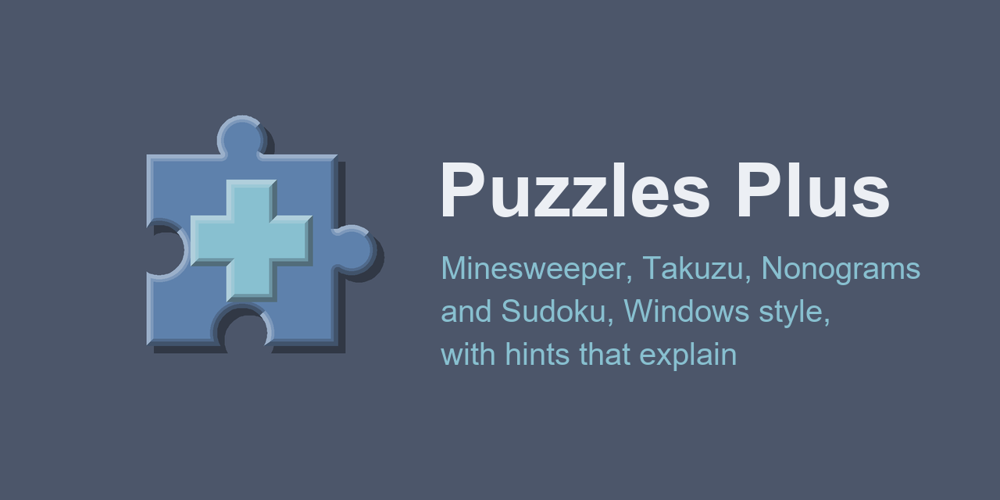</p>

# Puzzles Plus

Windows style puzzle games with hints that explain their reasoning, boards you can solve by logic alone and animated themes ported from xscreensaver, on a little Windows 95 desktop with a taskbar and Start menu. All five games share the window, the six themes and their backgrounds, pause, resume and the boss key, and your theme and zoom carry over between them.

| [Play Minesweeper Plus](https://fexofenadine.github.io/puzzlesplus/minesweeper/)                                        | [Play Takuzu Plus](https://fexofenadine.github.io/puzzlesplus/takuzu/)                              | [Play Nonograms Plus](https://fexofenadine.github.io/puzzlesplus/nonograms/)                                    | [Play Sudoku Plus](https://fexofenadine.github.io/puzzlesplus/sudoku/)                              | [Play 2048 Plus](https://fexofenadine.github.io/puzzlesplus/2048/)                          |
| ----------------------------------------------------------------------------------------------------------------------- | --------------------------------------------------------------------------------------------------- | --------------------------------------------------------------------------------------------------------------- | --------------------------------------------------------------------------------------------------- | ------------------------------------------------------------------------------------------- |
| [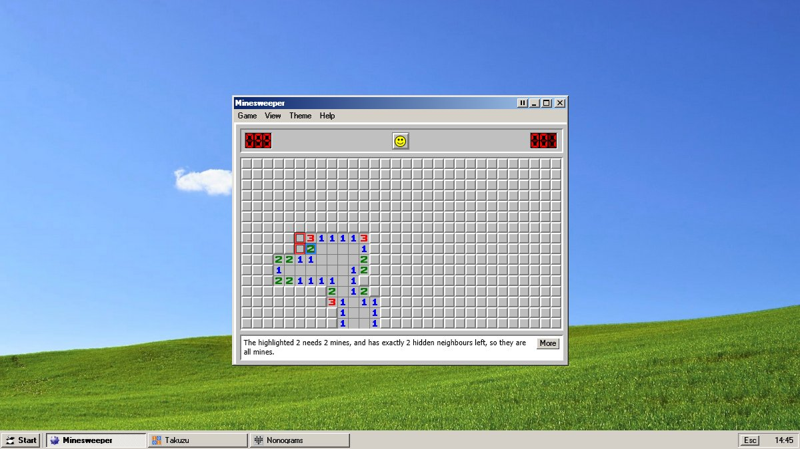](https://fexofenadine.github.io/puzzlesplus/minesweeper/) | [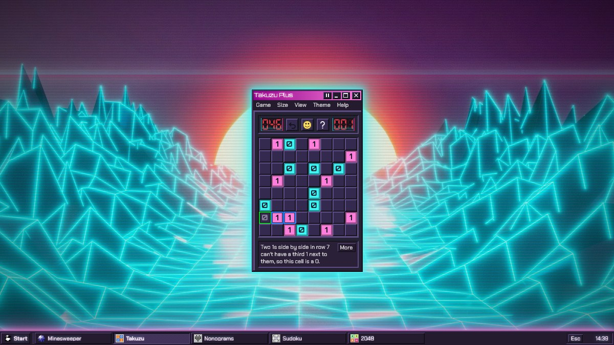](https://fexofenadine.github.io/puzzlesplus/takuzu/) | [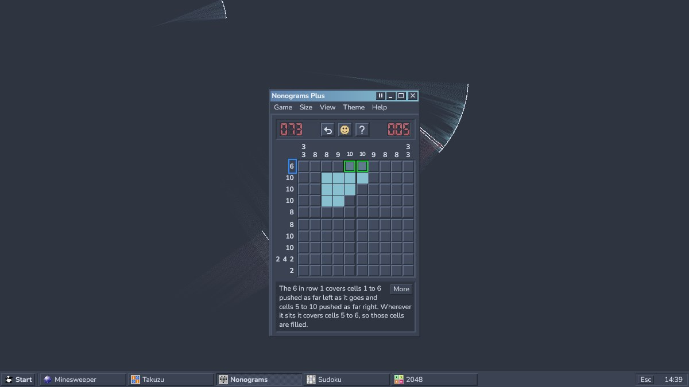](https://fexofenadine.github.io/puzzlesplus/nonograms/) | [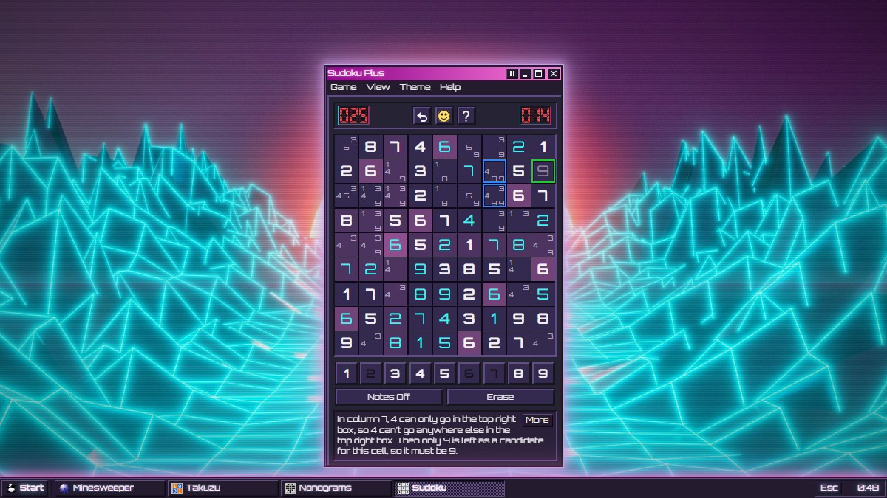](https://fexofenadine.github.io/puzzlesplus/sudoku/) | [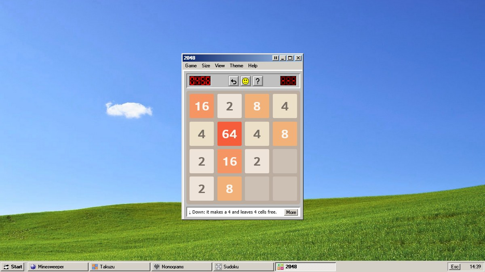](https://fexofenadine.github.io/puzzlesplus/2048/) |

Each game has a guide, from the rules to every solving technique (or, for 2048, strategy) with worked examples: the [Minesweeper](https://fexofenadine.github.io/puzzlesplus/minesweeper/guide/), [Takuzu](https://fexofenadine.github.io/puzzlesplus/takuzu/guide/), [Nonograms](https://fexofenadine.github.io/puzzlesplus/nonograms/guide/), [Sudoku](https://fexofenadine.github.io/puzzlesplus/sudoku/guide/) and [2048](https://fexofenadine.github.io/puzzlesplus/2048/guide/) guides. [How to Play](https://fexofenadine.github.io/puzzlesplus/how-to-play/) has every game's rules in short.

## In pictures

| Classic: a hint with its More button, and the Start menu                       | Classic's animated hill: Takuzu with Show Errors                            |
| ------------------------------------------------------------------------------ | --------------------------------------------------------------------------- |
| 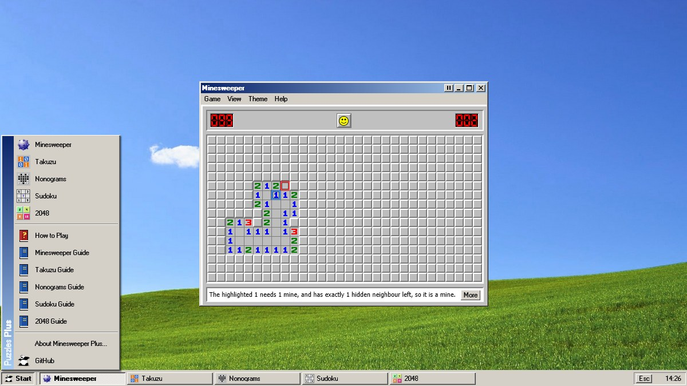            | 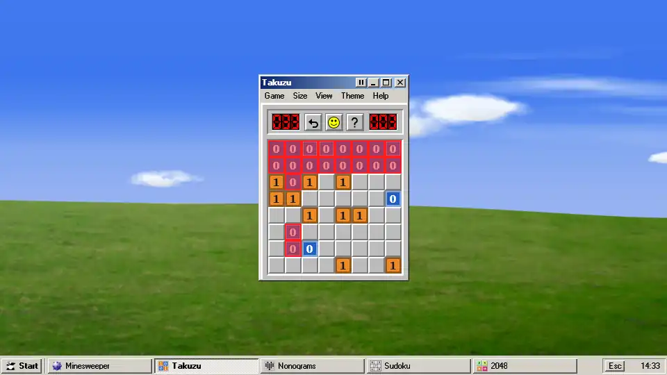 |
| **Synthwave: a lost Expert game glitching, and best times**                    | **Matrix: Nonograms with rain glyphs and a hint**                           |
| 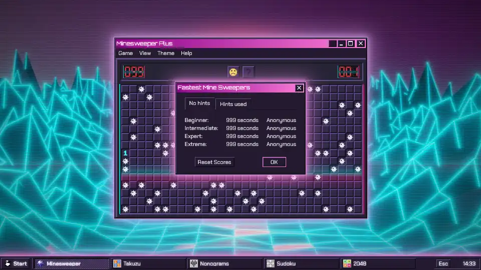       | 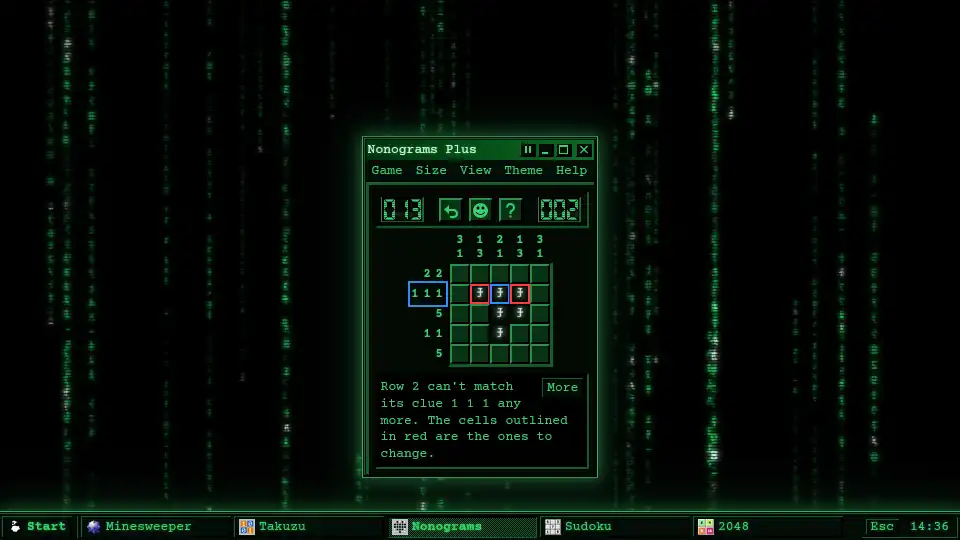              |
| **Nord: 25 × 25 Expert maximised over Substrate, with the View menu**          | **Solarized Truchet, still: a full Takuzu board with a mistake**            |
| 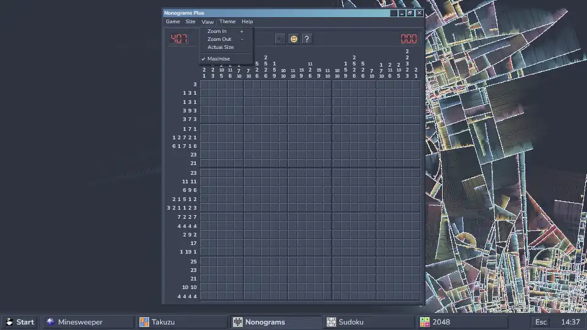                     | 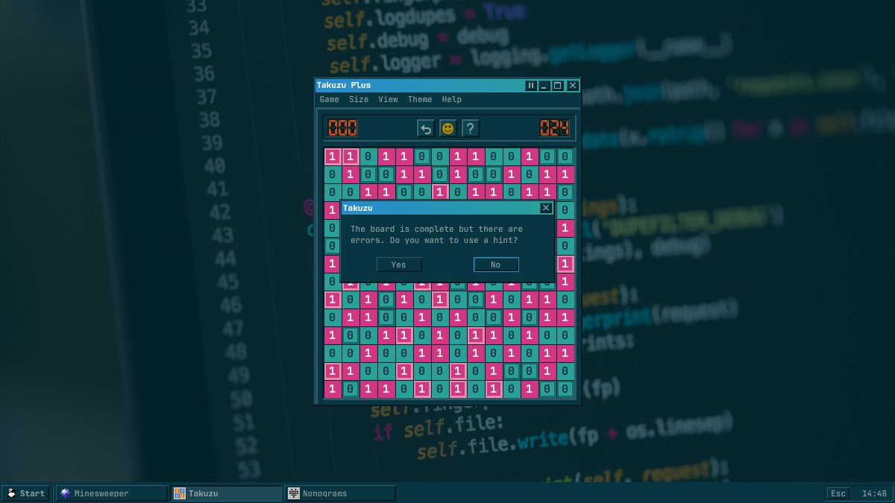       |
| **Solarized Phosphor: Open Games after closing a window**                      | **A guide page, its example drawn by the game's own code**                  |
| 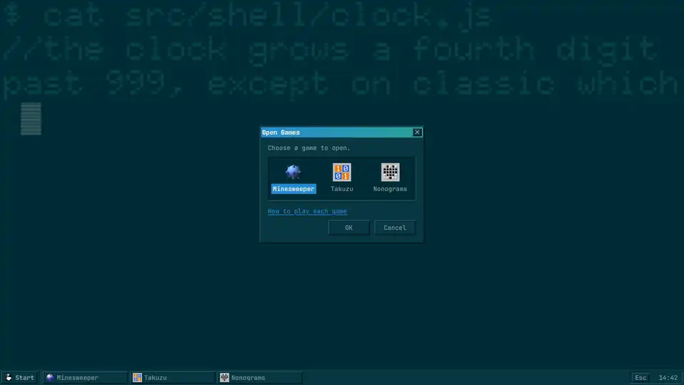 | 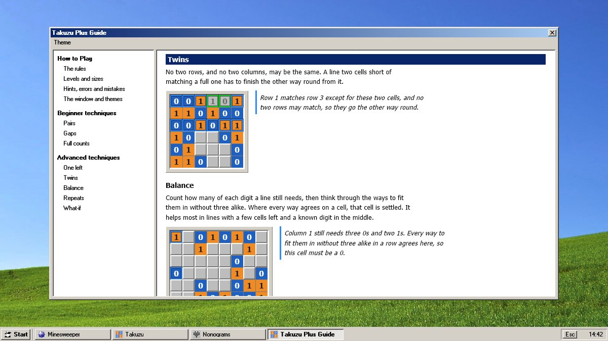                             |
| **Matrix: Sudoku with notes, a hint taking candidates away first**             | **Solarized Phosphor: 2048 with the hint's advice**                         |
| 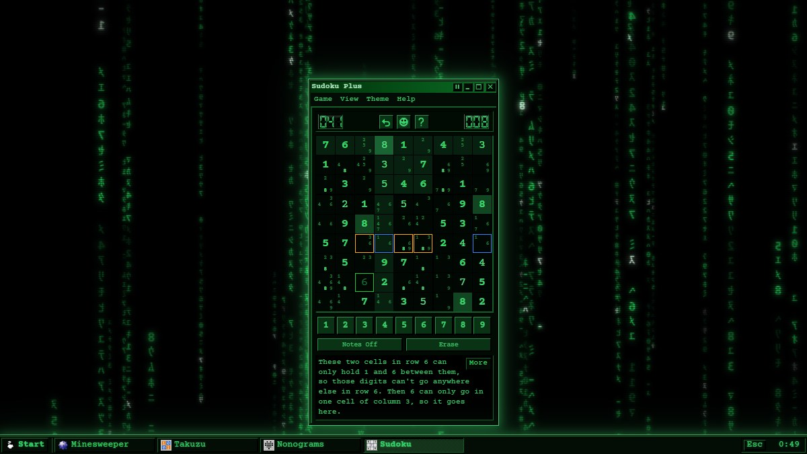                        | 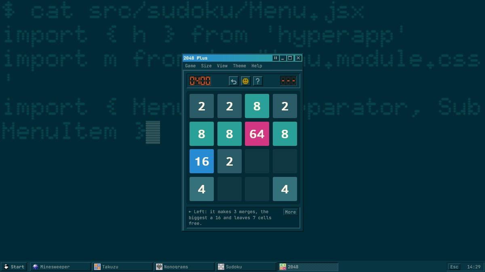           |

**Expert turned on its side on a phone, over Matrix's still wallpaper**

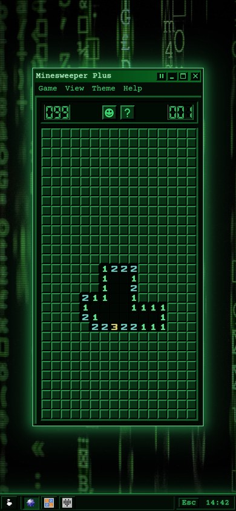

## Minesweeper Plus

A fork of [frenzzy/minesweeper](https://github.com/frenzzy/minesweeper), whose Classic theme still looks and plays like the original, plus:

- An **Extreme** level (39 × 21, 169 mines) beside Beginner, Intermediate, Expert and Custom.
- **Safe First Click** and **No Guessing**, which deals only boards logic alone can clear.
- **Hints** from the numbers you can see and your flags, explained under the board, and **chording** that explains itself when it can't open.
- Best times with and without hints, and wide boards turned on their side on portrait screens.

## Takuzu Plus

Fill the grid with 0s and 1s: no three alike in a row, as many 0s as 1s in every line, and no two rows or columns the same.

- Five levels from Easy to Expert and five sizes from 6 × 6 to 14 × 14, every board with one solution and graded by the reasoning it really needs.
- Hints that find broken rules and wrong cells before the next step, Show Errors, undo and a question when a full board is wrong.

## Nonograms Plus

Fill the cells whose runs match the clues beside each row and above each column, and a picture appears.

- Four levels and five sizes from 5 × 5 to 25 × 25, random pictures touched up until logic alone can finish them.
- Drag to paint along a line, crosses as notes, a fill or cross mode for touch screens, hints, Show Errors and undo.

## Sudoku Plus

Fill the grid so every row, column and box holds 1 to 9 once each.

- Four levels from Easy to Expert, every board with one solution and graded by the hardest technique it needs, from singles to the Swordfish and XYZ-Wing.
- A number pad under the board for touch screens and mice, the keyboard for everything, notes (with Auto Notes and notes that tidy themselves as digits go in), and a pick-a-digit-then-tap-cells mode.
- Hints that find repeats, wrong digits and notes that leave out the answer before the next step, and explain any candidate they take away to get there.

## 2048 Plus

Slide the tiles so equal ones merge, and make a 2048.

- Three board sizes from 3 × 3 to 5 × 5, best scores with the highest tile per size, kept apart for games that used help.
- Arrow keys or WASD, or swipe and drag on the board, with tiles that slide, merge and pop.
- Unlimited undo, and a hint that looks two moves ahead over the tiles that might appear and says why it picks its move.

## Every game

- **A desktop**: a taskbar with a Start menu, a button per game and a clock. Windows minimise to the taskbar, maximise to fill the page, and close to an Open Games dialog. Zoom from the View menu or with + and -.
- **Six themes**: Classic, Synthwave, Matrix, Nord, Solarized Truchet and Solarized Phosphor, most over an xscreensaver port with its original options, any of which can be switched to a still picture.
- **Hints with a More button** that opens their technique in the game's guide.
- **Pause**, automatic when you switch away, and a **boss key** (Esc) that hides everything behind a spreadsheet.
- **Resume**: a game in progress survives a reload or a closed tab and comes back paused. A **Timer** option turns the clock off (and best times with it).
- Best times per level, with and without hints, and an offline-capable service worker.

## Under the hood

- Rebuilt on [Vite](https://vite.dev) with Vitest, ESLint and Prettier, replacing the abandoned hyperapp-tools webpack 4 setup.
- A plain static build with readable asset names, versioned links so browsers never mix old and new files, and a simple offline-capable service worker.
- Settings survive browsers that block site storage, falling back to the defaults.
- The games and their guides are pages of one build. Code the games share (the taskbar and window, themes, backgrounds, zoom, pause, the boss key, best times, settings storage, dealing in a worker) lives in `src/shell`, Minesweeper keeps the original's file layout in `src`, Takuzu, Nonograms, Sudoku and 2048 have `src/takuzu`, `src/nonograms`, `src/sudoku` and `src/2048`, and the guides `src/guide`.
- The guides' examples are real positions from dealt boards, drawn with each game's own cells and captioned by its own hint code, and a test checks every one still shows its technique.
- Takuzu's, Nonograms' and Sudoku's rules, solvers, the technique ladders behind hints and difficulty, and the generators are plain modules with no interface code, and boards are dealt in a web worker. Nonograms solves a line by dynamic programming over every way its clue can fit. Sudoku's grid is built from units (rows, columns, boxes), so other sizes and variants are a few lines. 2048 moves plain values for its expectimax hint and tiles with ids for the view, so each tile keeps its element and slides by CSS transition.
- Animated backgrounds are canvas ports in `src/shell/backgrounds`, one file each. A port declares its options and the settings dialog builds itself from them, so adding another xscreensaver hack needs no other code. Phosphor's source code text is only downloaded when that theme is used.
- Google Analytics removed.
- Tests for mine placement and the no-guessing solver, chording and its explanations, hints, best times, zoom and fitting, portrait boards and every background and its settings, and for Takuzu's rules, solver (checked against a brute force search), every technique, difficulty rating, generation at every size and level, hints that always agree with the solution, and playing, and the same for Nonograms, whose line solver is checked against a brute force search and whose boards are played to the end by following hints, and for Sudoku, whose every technique is checked against the solution at every step of dozens of dealt boards.

## Development

```sh
yarn          #install dependencies
yarn start    #dev server, the games are at /minesweeper/, /takuzu/, /nonograms/, /sudoku/ and /2048/
yarn build    #static site in build/
yarn test     #run tests
yarn lint     #lint
yarn deploy   #build and publish to github pages
```

Classic's hill (`src/shell/backgrounds/hill.webp` and `ridge.json`) is made from the CC0 source photo by `src/shell/backgrounds/hill.py`, which needs Python with Pillow and numpy. The theme fonts are converted by `src/fonts/convert.mjs`.

## Credits

- Takuzu, also known as Binairo, was devised by Frank Coussement and Peter De Schepper. This version's puzzles, solver and hints are its own.
- 2048 is based on [2048](https://github.com/gabrielecirulli/2048) by Gabriele Cirulli (MIT licence), itself inspired by 1024 and Threes. The rules follow it; this version's code, hint and records are its own.
- Sudoku was devised by Howard Garns as Number Place in 1979 and named by Nikoli in 1984. This version's puzzles, solver and hints are its own.
- Nonograms were devised in 1987 by Non Ishida and, independently, Tetsuya Nishio. This version's pictures, solver and hints are its own.
- Forked from [frenzzy/minesweeper](https://github.com/frenzzy/minesweeper) by Vladimir Kutepov, bootstrapped with [Hyperapp Starter](https://github.com/kriasoft/hyperapp-starter).
- Classic background by [Chris Barbalis](https://unsplash.com/photos/green-grass-field-under-blue-sky--nYBR0LFTvQ) on Unsplash, colour matched to resemble Bliss.
- Classic's animated hill is cut from [Clouds above Cattle Hill, Roedean](<https://commons.wikimedia.org/wiki/File:Clouds_above_Cattle_Hill,_Roedean_(February_2011).JPG>) by Hassocks5489 (CC0), retouched, mirrored and colour matched to Bliss by `src/shell/backgrounds/hill.py`. Its sky and clouds are drawn live.
- Synthwave background by [Neeqolah Creative Works](https://unsplash.com/photos/a-computer-generated-image-of-a-sun-setting-in-the-distance-Tn5gnXGI3hI) on Unsplash.
- Synthwave colours from [SynthWave '84](https://github.com/robb0wen/synthwave-vscode) by Robb Owen.
- Matrix code rain is a canvas port of [GLMatrix](https://github.com/xscreensaver/xscreensaver/blob/master/hacks/glx/glmatrix.c) from xscreensaver by Jamie Zawinski.
- Matrix static background [Binary damage code](<https://commons.wikimedia.org/wiki/File:Binary_damage_code_(28227210988).jpg>) by Markus Spiske (CC0).
- Nord background is a canvas port of [Substrate](https://github.com/xscreensaver/xscreensaver/blob/master/hacks/substrate.c) from xscreensaver, by J. Tarbell ([complexification.net](http://complexification.net)) and Mike Kershaw.
- Nord colours from [Nord](https://www.nordtheme.com) by Arctic Ice Studio.
- Solarized static background by [Chris Ried](https://unsplash.com/photos/ieic5Tq8YMk) on Unsplash.
- Solarized Truchet background is a canvas port of [Truchet](https://github.com/xscreensaver/xscreensaver/blob/master/hacks/truchet.c) from xscreensaver by Adrian Likins.
- Solarized Phosphor background is a canvas port of [Phosphor](https://github.com/xscreensaver/xscreensaver/blob/master/hacks/phosphor.c) from xscreensaver by Jamie Zawinski, with its built-in public domain 6x10 font.
- Theme fonts [Orbitron](https://fonts.google.com/specimen/Orbitron) by Matt McInerney and The League of Moveable Type, [Courier Prime](https://fonts.google.com/specimen/Courier+Prime) by Alan Dague-Greene for Quote-Unquote Apps, [JetBrains Mono](https://www.jetbrains.com/lp/mono/) by JetBrains, [Nunito](https://fonts.google.com/specimen/Nunito) by Vernon Adams, Cyreal and Jacques Le Bailly and [Chakra Petch](https://fonts.google.com/specimen/Chakra+Petch) by Cadson Demak, all under the SIL Open Font License (licences in `src/fonts/`). 2048's tiles use [Clear Sans](https://github.com/intel/clear-sans) by Intel, as the original does, under the Apache License 2.0.
- Classic menu and title bar font is a pixel conversion of [Wine](https://gitlab.winehq.org/wine/wine)'s MS Sans Serif by Huw D M Davies and Dmitry Timoshkov, under the LGPL 2.1 (source, converter and licence in `src/fonts/`).
